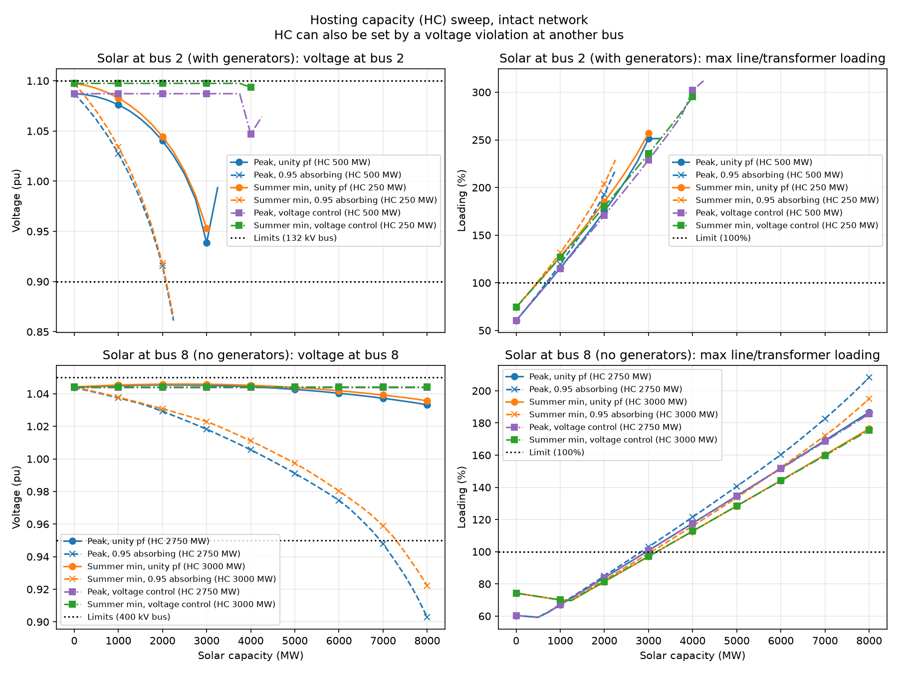
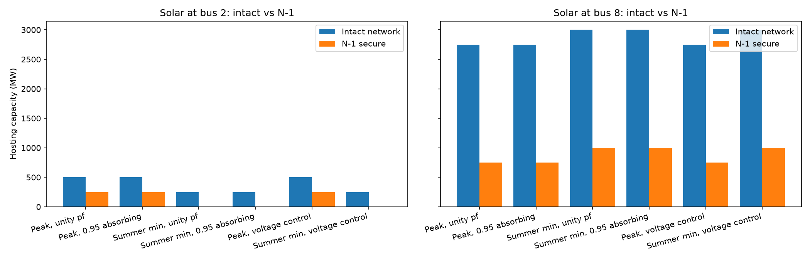

# Solar hosting capacity on the reduced GB transmission network

A power system study in Python with [pandapower](https://www.pandapower.org/). It asks how much solar a weak point on the Great Britain transmission network can take before voltage, thermal or N-1 security limits are breached, and how solar changes fault levels.

The network is pandapower's `GBreducednetwork()`: a 29-bus representative model of the GB transmission system (400, 275 and 132 kV) from the University of Edinburgh test case archive (W. A. Bukhsh and K. McKinnon). Each bus represents a whole region, so a "solar farm" here stands for the aggregated solar in that region.

## What the script does

`gb_power_system_study.py` is a single script split into `# %%` cells:

| Section | Study |
|---|---|
| 1 | Inspect the network |
| 1b | Dispatch: one AC optimal power flow (OPF) per demand level (peak, and summer minimum at 45% of peak), without solar |
| 2 | Base case AC load flow |
| 3 | N-1 line contingency screening of the base case |
| 4 | Short-circuit analysis (IEC 60909): 3-phase max/min and 2-phase |
| 5 | Add solar at two buses: the weakest bus (lowest fault level), and the weakest bus with no generators |
| 6 | Fault levels with solar |
| 7 | Hosting capacity sweep, 0–8000 MW in 250 MW steps |
| 8 | N-1 hosting capacity: the same sweep, but no line outage may be worse than without solar |

Six scenarios are swept at each bus: peak or summer minimum demand, each with the solar at unity power factor, at 0.95 power factor absorbing reactive power, or controlling voltage (±0.95 pf range).

### Method notes

- **Dispatch.** The generator outputs stored in the case are not balanced (about 73.7 GW of generation against 56.3 GW of load). An AC OPF sets a cost-optimal dispatch for each demand level, which is then frozen. All later studies are plain AC Newton–Raphson load flows with generator reactive limits enforced.
- **N-1 secure dispatch.** pandapower's OPF only checks the intact network. To approximate an N-1 secure dispatch, as the real system is run, each circuit of a double circuit is limited to 50% in the OPF, so it can take its partner's flow after an outage. With this, the base case passes N-1.
- **Voltage limits.** ±5% at 400 kV, ±10% at 275 and 132 kV.
- **Pass/fail test.** A solar size fails if any bus leaves its voltage limits, or any line or transformer goes above 100%, where it was within limits without solar. An element already outside its limits without solar fails only if it gets worse by more than 0.005 pu or 1 percentage point.
- **Redispatch for solar.** Conventional generators are turned down in proportion to make room for the solar.

## Results

| Bus | Scenario | Intact hosting capacity | N-1 hosting capacity | Limited by |
|---|---|---|---|---|
| 2 (132 kV, 4 generators) | Peak | 500 MW | 250 MW | Transformers 10/11; lines 0/1 under N-1 |
| 2 | Summer minimum | 250 MW | 0 MW | Transformers 10/11 when line 2 or 3 is out |
| 8 (400 kV, no generators) | Peak | 2750 MW | 750 MW | Lines 14/15 (bus 8 to bus 10) |
| 8 | Summer minimum | 3000 MW | 1000 MW | Lines 14/15 |

Each limit is the same for all three reactive power modes: the limits are thermal, not voltage. 2000 MW of solar raises the 3-phase fault current by 15.7% at bus 2 and 7.9% at bus 8 (inverter fault current limited to 1.2 × rated).

| Hosting capacity sweep | Intact vs N-1 |
|---|---|
|  |  |

All tables (CSV) and figures (PNG) are in [`results/`](results/).

## Assumptions and limitations

- **Short-circuit data is assumed.** The case has none. The values (grid strength, generator subtransient reactance, inverter current limit) are listed at the top of the script.
- **Snapshot study.** Two demand levels, not a time series; no dynamics or protection coordination.
- **N-1 covers line outages only**, not transformers or generators.
- **The 50% double-circuit rule is an approximation.** It assumes the two circuits are equal and does not protect single circuits or transformers. In a meshed network it is also conservative, because some of a lost circuit's flow goes elsewhere.
- **Redispatch ignores minimum outputs and unit commitment.** All generators are turned down by the same proportion.
- **Solar voltage control.** Its reactive range scales with output (±0.95 pf).
- **Resolution.** Hosting capacities are accurate to 250 MW.
- **2010-era generation mix.** The network model dates from around 2010.

## Running it

Requires Python 3.12.

```
py -3.12 -m venv .venv
.venv/Scripts/python -m pip install -r requirements-lock.txt
.venv/Scripts/python gb_power_system_study.py
```

On macOS/Linux use `python3.12 -m venv .venv` and `.venv/bin/python`. A full run takes a few minutes, most of it in the N-1 sweeps of Section 8. The study settings (solar buses, sweep sizes, limits, tolerances) are constants at the top of the script.
